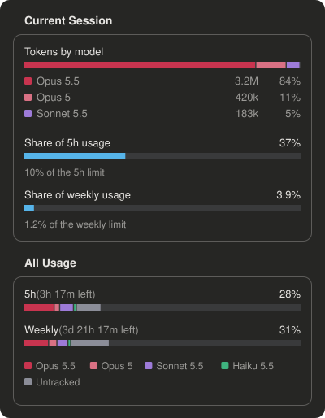

# Claude Session Usage

See how much of your Claude plan each session is using, broken down by model, right next to your chat.

<p align="center"></p>

## Why

Claude Code tells you how much of your 5-hour and weekly limits you have used, as one number for your whole account. It doesn't tell you where that usage came from.

When you work in several sessions at once, or switch between Opus and Sonnet, you can't tell which session or which model is eating your limit. You end up guessing, or hitting the limit without knowing why.

This plugin answers that. Every session shows its own usage, split by model, and what share of your 5-hour and weekly limits it is responsible for.

## What you get

A **Usage** pane that opens with every session, in two parts.

**Current Session**

- **Tokens by model**: how this session's tokens split between models, with each model's count and percentage
- **Share of 5h usage**: how much of the usage in the current 5-hour window came from this session, and how much of the whole limit that is
- **Share of weekly usage**: the same for the weekly limit

**All Usage**

- **5h** and **Weekly** bars with the time left until each resets, colored by model across all your sessions
- Grey shows usage the plugin didn't see, such as claude.ai in the browser or another computer

Each model family keeps the same color everywhere: Opus is crimson, Sonnet purple, Haiku green. Older versions of a family use a lighter shade.

## Install

You need Claude Code signed in with a Claude subscription, such as Pro or Max. The 5-hour and weekly limits only exist on subscription plans.

### Desktop app

1. Click **+** next to the prompt box
2. Choose **Plugins**, then **Add marketplace**
3. Enter `Mahdi-Alz/claude-session-usage`
4. Click **Add plugin** next to **usage-monitor**

### Terminal

Type this at the Claude Code prompt:

```
/plugin install usage-monitor --marketplace Mahdi-Alz/claude-session-usage
```

Answer `y` to add the marketplace, then press Enter to install for your user.

Or from your shell:

```
claude plugin install usage-monitor --marketplace Mahdi-Alz/claude-session-usage
```

### After installing

Start a new session. The Usage pane opens by itself. If you close it, type `/usage-monitor` to bring it back.

The limit bars appear after the first reply in a session, or straight away if another session has already seen them.

## How the numbers work

Claude Code reports your limits as a single percentage per window, with no breakdown. The plugin works out the breakdown itself:

- Each session records the tokens it uses per model and shares that with your other sessions on the same computer
- Tokens are weighted by price, because a token of Opus output counts for much more of your limit than a cached token of Haiku
- Usage that was already on the limit before the plugin saw the window counts as untracked
- Everything else is split between sessions and models by their weighted usage

The total percentages and the time left come straight from Claude Code. The split between sessions and models is an estimate, and it is only as complete as the sessions running the plugin.

## Uninstall

In the terminal:

```
claude plugin uninstall usage-monitor
```

In the desktop app, remove it from **+ → Plugins**.

## License

MIT
